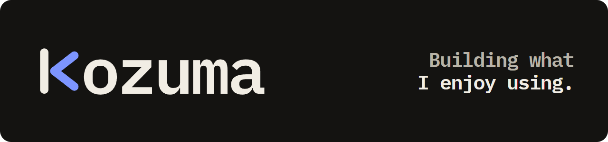
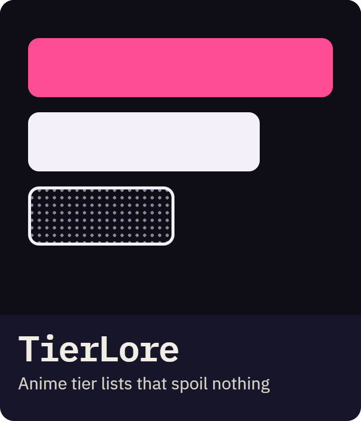
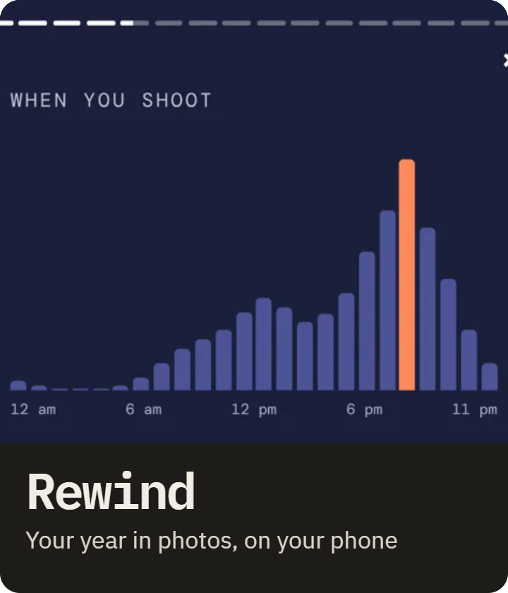
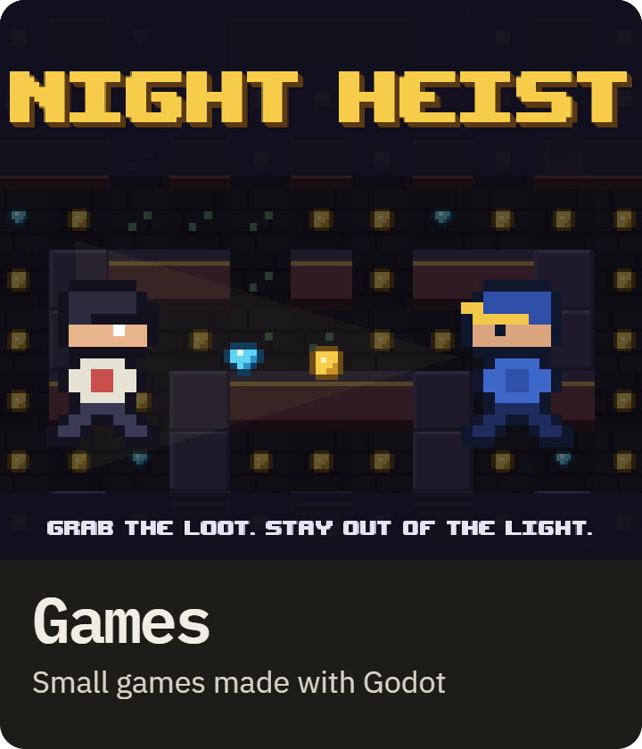

<picture>
  <source media="(prefers-color-scheme: dark)" srcset="assets/banner-dark.png">
  <source media="(prefers-color-scheme: light)" srcset="assets/banner-light.png">
  
</picture>

Independent developer behind [Kozuma](https://kozuma.studio).

  

**Before:** the common core at 42, and a web developer diploma at Simplon. [The whole journey](https://kozuma.studio/#carnet)

**Say hi:** contact@kozuma.studio
